# Lunar Landing Site Navigator: System Architecture
## NASA Space Apps Challenge 2026

```mermaid
flowchart TD
    subgraph UI ["Frontend (Single-Page 3D App)"]
        F1["3D Planetary Sphere Renderer"]
        F2["Regional Explorer & Terrain Cards"]
        F3["Solar Illumination & Battery Calc"]
        F4["Earth Link & Telemetry Monitor"]
        F5["15-Parameter Comparison Matrix"]
        F6["Landing Site Recommendation Deck"]
    end

    subgraph API ["Backend REST Server (Python)"]
        S1["/api/overview & /api/sites"]
        S2["/api/elevation"]
        S3["/api/slope"]
        S4["/api/roughness"]
        S5["/api/safety-score"]
        S6["/api/distance"]
        S7["/api/navigation-path"]
        S8["/api/illumination"]
        S9["/api/hazards"]
        S10["/api/comparison"]
    end

    subgraph Core ["Calculation Engine (calculator.py)"]
        C1["Horn's Convolution (Slope)"]
        C2["Terrain Roughness Index (TRI)"]
        C3["A* Rover Pathfinding"]
        C4["Horizon Ray-Tracing (Shadows)"]
        C5["Haversine & 3D Euclidean (Distance)"]
        C6["MCDA Landing Suitability Scoring"]
    end

    subgraph Data ["Data Layer (data/)"]
        D1["lunar_elevation_grid_5m.json"]
        D2["lunar_waypoints.json"]
        D3["crater_hazards.json"]
        D4["solar_illumination_ephemeris.json"]
        D5["calculation_parameters.json"]
    end

    UI <-->|HTTP JSON REST / CORS| API
    API <--> Core
    Core <--> Data
```

### Module Breakdown
* **`frontend/`**: Interactive canvas 3D solar system entrance, multi-module dashboard, regional inspector, comparison matrix, and solar power calculators.
* **`backend/`**: Zero-dependency REST API server (`backend/server.py`) powered by `LunarCalculator` (`backend/calculator.py`).
* **`data/`**: Pure numerical datasets derived from NASA LOLA PGDA Product 78, USGS Artemis Navigational Grids, and NASA JPL Horizons.
* **`docs/`**: Engineering calculations guide, API documentation, and setup manuals.
